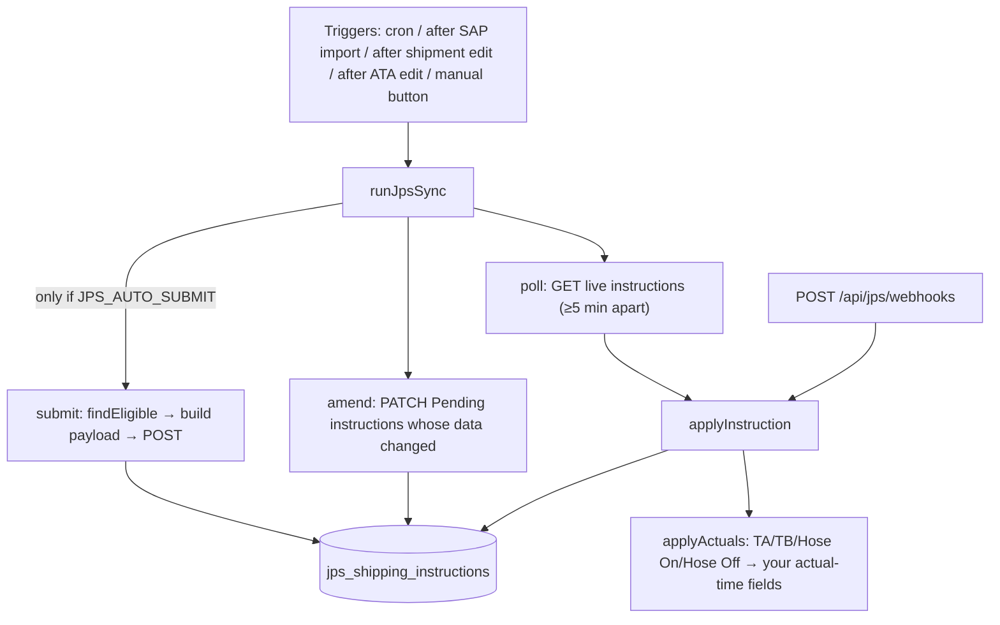

# KLIP ↔ JPS Integration — Reference for Applications Following the Same Mechanism

> **Audience:** developers (and coding agents) of another application that is about to integrate with the **Jetty Planning System (JPS)** and wants to reuse the mechanism KLIP already runs.
> **Source of truth for this document:** the KLIP code in `backend/src/jps/` plus the JPS partner guide `docs/INBOUND-SHIPPING-INSTRUCTION-PARTNER-API.md` (JPS API **v5.7**, header `X-JPS-API-Version: 5.7`).
> **What this document is — and is not:**
> - It **is** the *mechanism*: when to send, how to build the payload, how to stay idempotent, how to track status, how to handle webhooks, which edge cases bit KLIP, and a build checklist.
> - It is **not** a replacement for the JPS wire contract. For exact field limits, enums and error shapes always read the JPS guide and call `GET /catalog` (live contract). Where this document and the JPS guide disagree, **JPS wins**.
> - Sections marked **[KLIP-specific]** describe KLIP's own data model (STO, Master Port, DHM codes). Replace them with your application's equivalents; the *pattern* is what to keep.

---

## 0. TL;DR — the mechanism in ten lines

1. The integration is **outbound-first**: your app calls JPS (`x-api-key`), JPS never needs to reach into your DB. Webhooks are an optional accelerator; **polling is the fallback and always exists**.
2. One **Shipping Instruction (SI) per vessel call** (KLIP: per **STO**, with one `cargo[]` line per PO/contract) — not one per row of your shipment table.
3. A local **tracker table** (one row per *attempt*, keyed by business key + `revision`) is the only memory of the conversation with JPS.
4. **Idempotency** = `external_reference = <APP>-<businessKey>-R<revision>`. JPS enforces it unique per API key; a `409 DUPLICATE_REFERENCE` is recovered with `GET ?external_reference=`.
5. **Retry only what is retryable** (`429`, `5xx`, network). `400/401/404/409` are permanent: store the message, do not loop.
6. **Never guess master data.** If a hub code (port / vessel / commodity / company) is missing, **hold** the STO with a human-readable reason; it is re-evaluated on the next sweep.
7. **Amend** (`PATCH`) only while JPS status is `Pending`, and only the fields JPS allows; `eta`/`etd` are **not** amendable.
8. A `Rejected` or `Deleted` instruction is **closed**; sending again creates a **new revision** (`R2`, `R3`…) and is a deliberate user action, never an automatic retry.
9. JPS **actuals** (TA, TB, Hose On, Hose Off) flow back into your own actual-time fields, converted to your business time zone **in SQL/with the zone attached** (not by chopping the UTC string).
10. Log **every** JPS call (without the API key) so a 500 or timeout leaves a trace even when no tracker row is written.

---

## 1. Context: what JPS does and what KLIP uses it for

JPS is the jetty/berth planning system. A partner app submits a Shipping Instruction; a JPS operator reviews it (approve / reject / delete), allocates a jetty, and later logs milestones. JPS exposes this through the Partner API (`/api/v1/integrations`).

KLIP uses JPS **inbound only** (`purpose: "Unloading"`): vessels arriving at a switched-on discharge port (today PORT BONTANG). KLIP:

- sends an SI when a shipment is on its way (loaded, not yet arrived) and the data is complete;
- reads back the operator's decision and the jetty/berth times;
- shows the status in the Shipments list (**Jetty Status** column) and writes JPS's actual times into KLIP's discharge ATA fields.

JPS lifecycle (partner `status`, v5.7):

```
Pending → Approved → Allocated → Berthed → Start Cargo → Cargo Done → Sailed Off
   │         │
   ├─ Rejected (closed, has rejection_reason)
   └─ Deleted  (closed; operator deleted the plan; GET still works, same external_reference stays used)
```

KLIP also tolerates `Hose On` / `Hose Off` as live statuses (seen on JPS's production catalog; not in the v5.7 guide). **Rule for your client: accept unknown status strings** and store them verbatim; only a small set is treated as terminal (see §9).

---

## 2. Architecture (what to build, what each piece does)

KLIP's code lives in `backend/src/jps/`. The files map one-to-one to responsibilities you can reproduce:

| Concern | KLIP file | Responsibility |
|---|---|---|
| Settings | `config.ts` | Reads all `JPS_*` settings (admin screen value wins over `.env`). |
| HTTP client | `client.ts` | `x-api-key`, timeout, **no throw on HTTP errors**, classifies results as retryable/permanent, logs every call. |
| Wire types | `types.ts` | Request/response shapes, live vs closed status sets. |
| Who is owed an SI | `eligibility.ts` | One SQL that answers "which STOs must be sent now" + the cargo/trade-term data. |
| Payload builder | `mapper.ts` | Business data → JPS payload; returns **problems** (reasons to hold) instead of a bad payload. |
| Submit | `submit.ts` | POST, revisioning, 409 recovery, writes the tracker row. |
| Manual submit + readiness | `manualSubmit.ts`, `readiness.ts` | User-pressed "Submit to Jetty": runs a per-condition checklist first. |
| Amend | `amend.ts` | PATCH while `Pending`, diff against the stored payload. |
| Poll | `poll.ts` | GET live instructions respecting JPS's polling limit. |
| Webhook | `webhook.ts`, `webhookHandler.ts` | Signature check, dedupe, apply. |
| Apply | `applyInstruction.ts`, `applyActuals.ts` | **Single** function that writes a JPS snapshot into the tracker and into your own actual-time fields; used by poll **and** webhook. |
| Catalogs | `companies.ts`, `portCatalog.ts` | Cached `GET /catalog/company` and `/catalog/port`. |
| Ports switch | `ports.ts` | Which of your ports are enabled for JPS (admin-edited JSON). |
| Orchestration | `index.ts` (`runJpsSync`) | submit → amend → poll, never throws into callers. |
| Call log | `callLog.ts` | Persists each call (`jps_api_calls`). |

Flow (one sweep):



Design rules worth copying as-is:

- `runJpsSync` is **fire-and-forget** from save paths (`void runJpsSync('shipment-edit')`) — JPS being slow or down must never delay a user save. It swallows its own errors.
- Order is fixed: **submit → amend → poll**. Amending before polling means a `Pending` instruction gets your latest PO/STO before you ask what JPS thinks of it.
- Poll and webhook converge on **one** `applyInstruction` function, so the two paths can never drift apart.

---

## 3. Onboarding checklist (outside the code)

Ask the JPS team for / do the following **before** writing code:

| # | Item | Notes |
|---|---|---|
| 1 | **API key for your app** (`jps_live_…`) | One key per integrating system. Server-side only. Shown once. Keys are **not** port-scoped. |
| 2 | **Base URL** per environment | Staging: `http://172.28.92.56:3080/api/v1/integrations`. Production: provided at go-live (`https://<host>/api/v1/integrations`). |
| 3 | **Network reachability** from your server | Check `GET /api/v1/health` (staging via the frontend proxy `:3080`). |
| 4 | **Hub codes** your app must carry | `port_hub_code` (`GET /catalog/port`), `vessel_hub_code` (DataHub vessel code), `cargo[].cargo_hub_code` (`GET /catalog/cargo-type`), `company_hub_code` (`GET /catalog/company`). All are **required by JPS v5.3+** except company (see §6). |
| 5 | **Port set-up at JPS** | JPS must have configured the port (jetty, mapped companies) before you switch it on. A port JPS does not know returns 400. |
| 6 | **Webhook registration** (optional but recommended) | `POST /webhooks {url, events:[status.changed, schedule.updated]}`; secret `whsec_…` is shown **once**. Max 3 active endpoints per key. JPS needs your URL to be reachable from JPS. |
| 7 | **Support contact** | Always quote `request_id` from errors. |

KLIP gets the DHM hub codes from its own DataHub (**DHM**) master sync (Master Port, Master Vessel, Master Product, Master Company → `code_dhm` / `dhm_code`). If your app has no DHM sync, you need **some** persistent mapping from your master data to JPS hub codes (a mapping table maintained by admins is acceptable). Do not hard-code them.

---

## 4. Settings (what KLIP exposes to admins)

All read through one helper so an admin screen value beats `.env`. Secrets are encrypted at rest (AES-256-GCM, key in `.env` only). The same set is a good template:

| Setting | Default | Purpose |
|---|---|---|
| `JPS_ENABLED` | off | Master switch. Needs base URL + key. Restart-required (it registers the cron). |
| `JPS_API_BASE_URL` | — | Up to and including `/api/v1/integrations`. |
| `JPS_API_KEY` | — | Secret. Never logged, never stored in the call log. |
| `JPS_WEBHOOK_SECRET` | — | `whsec_…`. No secret ⇒ the webhook endpoint refuses everything. |
| `JPS_PORTS` | none | JSON list `[{"port":"<Master Port>","enabled":true}]`. **No port is built into code**; with none enabled nothing is sent. A port can only be enabled if it already has a hub code. |
| `JPS_SWEEP_CRON` | `*/15 * * * *` | Safety-net sweep. Restart-required. |
| `JPS_TIMEOUT_MS` | 30000 | HTTP timeout. |
| `JPS_MIN_POLL_INTERVAL_MS` | 300000 | JPS allows **max one poll per instruction per 5 min**. Floor 60000. |
| `JPS_MAX_SUBMITS_PER_SWEEP` | 25 | Keeps one sweep far below JPS's **120 requests/min per key**. |
| `JPS_AUTO_SUBMIT` | **off** | When off nothing is sent on its own; a user presses **Submit to Jetty**. Amend and poll still run. Takes effect immediately. |
| `JPS_RETRY_FAILED` / `JPS_RETRY_FAILED_AFTER_MS` | off | **Testing only**: re-offer a rejected submission after it went cold. |

Recommended posture for a new app: **ship with auto-submit off**, validate with manual submits, then enable auto-submit port by port (KLIP did exactly this; auto-submit was switched off by default on 2026-10-30 after the pilot).

---

## 5. The tracker table (`jps_shipping_instructions`)

JPS cannot be queried by your business key, only by the `external_reference` you chose or its own id. The tracker is therefore the system of record for the conversation. Grain: **one row per attempt**; unique on `external_reference` and on `(sto_key, revision)`.

| Column | Meaning |
|---|---|
| `sto_key` | Business key (KLIP: the **same STO key the Shipments list groups by** — see gotcha G2). |
| `external_reference` | `KLIP-<sto_key>-R<revision>`, ≤ 100 chars. |
| `revision` | 1, 2, 3… |
| `state` | KLIP-side state (below). |
| `jps_id`, `jps_status` | JPS's id and status, copied verbatim. |
| `rejection_reason`, `jetty_name`, `jetty_code`, `planned_berthing_time`, `plan_reference`, `etr_minutes`, `approved_at`, `rejected_at` | Copied from JPS's GET/webhook. |
| `schedule_eta/ta/etb/tb/etc/tc/cast_off_at/sailed_at/cargo_ops_start_at/cargo_ops_end_at` | JPS `schedule` block, `TIMESTAMPTZ`. Kept **separate** from your own actual fields. |
| `payload` (jsonb) | Exactly what was sent (and later amended). Used to diff for PATCH. |
| `submitted_at`, `last_polled_at`, `last_error`, `request_id` | Bookkeeping. `last_polled_at` is stamped even when the poll **failed**, so a broken instruction cannot be hammered. |

### KLIP-side `state`

| `state` | Meaning | Sent to JPS? |
|---|---|---|
| `SUBMITTED` | JPS accepted (has `jps_id`). Its lifecycle is then `jps_status`. | Yes |
| `FAILED` | JPS refused with a **permanent** 4xx. `last_error` holds JPS's message + `details` (incl. `valid_*` allowed values) + `request_id`. | No (JPS never created it) |
| `SKIPPED_NO_CARGO` | **Held** by KLIP before sending: master data missing/odd. Reason in `last_error`. Re-evaluated every sweep. | No |
| `SKIPPED_PRE_EXISTING` | Go-live seed: STOs that already qualified when the integration launched. Never sent (no backfill). | No |
| `PENDING_SUBMIT` | Reserved in the CHECK constraint; not used for flow. | — |

A **retryable failure** (429, 5xx, timeout) writes **no row**: the next sweep simply tries again; a duplicate is recovered by reference. The call log still shows the failure (§12).

### Which row "stands for" the STO (UI/readiness rule)

An STO can accumulate several rows (R1 rejected, R2 submitted…). The one shown is chosen by:

```sql
ORDER BY (state = 'SUBMITTED' AND COALESCE(jps_status,'') NOT IN ('Rejected','Deleted')) DESC, revision DESC
```

i.e. the live instruction JPS holds wins over a newer held/failed row; a closed (Rejected/Deleted) row only shows if nothing newer exists. Use **one** definition everywhere (list, edit modal, readiness).

### Revision rule (`nextRevision`)

`next = highest existing revision + 1`, **except**: if the latest row is `FAILED` or `SKIPPED_NO_CARGO`, **reuse its revision** — JPS never saw that reference. (Without this, an STO held for 8 sweeps went out as `R9`, and migration 250 had to delete the superseded held rows.)

---

## 6. When to send: the eligibility rule **[KLIP-specific, pattern reusable]**

KLIP sends an SI for an STO when **all** hold (`eligibility.ts`):

1. Discharge **Master Port is switched on** in `JPS_PORTS` (resolved from `shipments.discharge_master_port_id`, else the active discharge leg's `master_port_id`; no Region/Site condition — JPS only knows the port).
2. **ATC Loading is filled** (SAP import or user edit; user override wins via `COALESCE(override, sap)`).
3. **No discharge ATA of any kind** (arrival, berthed, start, complete).
4. Shipment status **not** `COMPLETED`/`CANCELLED`.
5. **ETA discharge arrival is filled** (JPS requires `eta`).
6. **No tracker row** that already settles it: `SUBMITTED`/`SKIPPED_PRE_EXISTING` block for good; `FAILED` blocks (a 400 is permanent) unless `JPS_RETRY_FAILED`; `SKIPPED_NO_CARGO` does **not** block (re-evaluated).

Why both guards 3 and 4 exist (measured on a production copy): the ATA condition alone matched 58 STOs of which 57 were already COMPLETED; the status guard alone let 3 arrived-but-not-updated STOs through. Together: 1. **Calibrate your own rule on real data before go-live.**

Other principles:

- **Grain = STO.** 470 of 1,042 STOs had more than one `shipments` row (one per PO). Submitting per row would ask JPS to berth the same vessel several times, and every repeat gets 409. Aggregate to the business key; one `cargo[]` line per PO/contract.
- **Delta only, no backfill.** A SAP import bumps `updated_at` on thousands of rows, so "changed since deploy" is noise. KLIP seeded every already-eligible STO as `SKIPPED_PRE_EXISTING` in the migration instead of using a timestamp watermark.
- **Triggers** (all call `runJpsSync`): cron; after every SAP import (chained after the contract snapshot refresh so the sweep sees fresh data); after a shipment save; after an ATA override save; plus the manual button.
- The **manual path** (`POST /api/shipments/:id/jetty/submit`, needs `data.shipments:can_edit`, audited as `SUBMIT_TO_JETTY`) runs `checkJpsReadiness` first — a read-only checklist that evaluates **each condition separately** and says *where to fix it* (shipment / master port / master vessel / master product / master company / SAP / JPS / settings). It also warns when a resubmission would repeat the exact payload JPS rejected (`samePayloadIgnoringReference`).
- `POST /api/shipments/:id/jetty/refresh` (needs only view right) reads one instruction from JPS and stores it, honouring the poll limit (`too_soon`).

---

## 7. Building the payload (`mapper.ts`)

### 7.1 Example (shape KLIP sends)

```json
{
  "external_reference": "KLIP-1234567890-R1",
  "requested_by": "sap-data-import",
  "port_hub_code": "PORT-0048",
  "vessel_hub_code": "VSL-0036",
  "company_hub_code": "ORG-0006",
  "purpose": "Unloading",
  "eta": "2026-11-20T00:00:00Z",
  "etd": "2026-11-22T00:00:00Z",
  "agent_name": null,
  "trade_term": "FOB",
  "contract_document_url": "https://klip.example/api/documents/<id>/view",
  "shipping_instruction_document_url": "https://klip.example/api/documents/<id>/view",
  "bl_document_url": "https://klip.example/api/documents/<id>/view",
  "cargo": [
    {
      "cargo_hub_code": "CMD-0006",
      "tonnage": 5000.25,
      "unit": "MT",
      "contract_no": "CTR-7788",
      "po_no": "PO-12345",
      "sto_no": "1234567890"
    }
  ]
}
```

### 7.2 Field mapping

| JPS field | KLIP source / rule | If missing |
|---|---|---|
| `external_reference` | `KLIP-<stoKey>-R<revision>` | — |
| `port_hub_code` | Master Port `code_dhm` of the **discharge** port | **Hold** (a port deleted in DHM gives no code → hold with "deleted" reason) |
| `vessel_hub_code` | Master Vessel `dhm_code`; vessel resolved the *same way the Shipments page does* (own link → code alias → vessel code → normalized name) | **Hold**. `vessel_name` is **not** sent (JPS cross-checks it and returns 400 on mismatch) |
| `company_hub_code` | Master Company (Internal) `code_dhm`, resolved from the contracts' SAP company code (DHM `company_code_sap` match first, then KLIP's own `company_code`). Only sent when JPS's `GET /catalog/company` says the port has **≥ 2** mapped companies, or exactly one and it matches | Catalog says ≥ 2 and we can't pick ⇒ **Hold**. Catalog unknown/unreachable ⇒ nothing sent, nothing held |
| `purpose` | Constant `"Unloading"` (KLIP is inbound) | — |
| `eta` | Discharge **ETA arrival**, sent as `YYYY-MM-DDT00:00:00Z` preserving the **calendar day** (built from local date components, not `toISOString()` of a local-midnight date) | **Hold** |
| `etd` | Discharge ETA complete, **only if after `eta`** (JPS requires etd > eta) | omitted |
| `agent_name` | Always `null` | — |
| `trade_term` | Contract trade term, **only** `FOB`/`CIF`/`CFR` (JPS `GET /terms`) | omitted |
| `requested_by` | Acting user's email (manual) or `sap-data-import` (sweep) | — |
| `contract_document_url` / `shipping_instruction_document_url` / `bl_document_url` | Links to your own document endpoint (`/api/documents/:id/view` for Contract/SI/BL since 2026-10-29; `/download` otherwise). JPS stores the URL only; **http and https both accepted since v5.3** | omitted |
| `cargo[].cargo_hub_code` | Master Product `code_dhm` (e.g. CPO `CMD-0006`). Legacy `cargo_type` is refused by JPS ≥ 5.3 | **Hold** |
| `cargo[].tonnage` | **SAP STO quantity** (kg → MT, 2 dp) — *not* the contract quantity | **Hold** if STO qty exceeds contract qty by > 10 % (looks like bad data) |
| `cargo[].unit` | `"MT"` (JPS also allows `"KL"`) | — |
| `cargo[].contract_no`, `po_no` | From the line | — |
| `cargo[].sto_no` | Only if the line has its **own** STO; ≤ 100 chars | omitted |
| `shipper_name`, `surveyor_name` | **Never sent** (they must pre-exist at JPS via `POST /shippers`, and KLIP chose not to maintain them) | — |

### 7.3 "Hold, don't guess"

The builder returns `{ payload } | { problems[] }`. Problems are human sentences ("Master Product 'X' has no DHM code…"). They are stored in `last_error` on a `SKIPPED_NO_CARGO` row (same revision), shown in the Shipments list as **On Hold**, and classified (`classifyPayloadProblem`) so the readiness dialog points to the right master page. Hold reasons in KLIP:

- port / vessel / product / company has no hub code or is **deleted** at DHM;
- the port is **not in JPS `GET /catalog/port`** (JPS would answer 400; KLIP refuses earlier);
- company ambiguity (≥ 2 mapped, none chosen);
- missing ETA; no cargo line; suspicious STO quantity.

A hold is **not an error**: when someone fixes the master data the next sweep sends the instruction under the same revision.

### 7.4 Catalog lookups (cached)

- `GET /catalog/company` (which companies are mapped to which port) and `GET /catalog/port` (ports JPS knows): cached **10 minutes**; **failures are not cached**; an unknown catalog is treated as "don't block, don't send company".
- `GET /terms` is used by the admin "Test connection" button.

---

## 8. Submitting (`submit.ts`)

```
for each eligible STO (limit JPS_MAX_SUBMITS_PER_SWEEP):
    revision  = nextRevision(stoKey)
    payload   = build(stoKey, revision)            # or problems → hold
    if problems → upsert SKIPPED_NO_CARGO(last_error = problems), continue
    res = POST /shipping-instructions
    switch res:
      201                    → insert SUBMITTED (jps_id, jps_status=Pending, payload, submitted_at)
      409 DUPLICATE_REFERENCE→ GET ?external_reference= → insert SUBMITTED with the id found
      400/401/404 (permanent)→ insert/upsert FAILED (message + details + valid_* + request_id)
      429 / 5xx / network    → write NO row; next sweep retries
```

Client rules (`client.ts`) worth copying:

- axios with `validateStatus: () => true`; results are a discriminated union `{ ok: true, data } | { ok: false, status, code, message, details, requestId, retryable }`. **Never throw for an HTTP status.**
- `retryable` is true only for `429`, `5xx` and network errors (`NETWORK_ERROR`). `400, 401, 404, 409` are permanent. JPS retry guidance: retry `429`/`5xx` with backoff; POST retries are safe.
- Special codes: `JPS_DISABLED`, `JPS_NOT_CONFIGURED` (no HTTP made).
- Cache the axios instance, but **reset it when settings change**.
- Build the failure message with JPS's `details[]` (field + issue + `valid_*` lists) and `request_id` — this is the text a user sees in the Shipments list tooltip, so it must be actionable.

Idempotency in one sentence: because `external_reference` is unique per key, a lost response (timeout after JPS created it) is harmless — the retry gets 409 and you recover the id.

---

## 9. Tracking status

### 9.1 Status sets

| Set | Values | Treatment |
|---|---|---|
| Live (poll) | `Pending, Approved, Allocated, Berthed, Hose On, Start Cargo, Cargo Done, Hose Off` | Polled every ≥ 5 min |
| Closed | `Rejected`, `Deleted` | Never polled again; **only a user** may resubmit (new revision) |
| Terminal-sailed | `Sailed Off` (older: `Sailed`) | Polled **every 6 h for 14 days** after sailing (`SAILED_POLL_EVERY_HOURS`, `SAILED_POLL_WINDOW_DAYS`) |

Why keep polling after sailing: **Hose Off (`cargo_ops_end_at`) is often recorded after `Cargo Done`**, and JPS recomputes schedule values on every GET (Opening can still change after the vessel finished; clearing Closing emits `schedule.updated` with `cargo_ops_end_at: null`). Stopping at `Sailed Off` would freeze KLIP on stale values.

### 9.2 Poll (`poll.ts`)

- `GET /shipping-instructions/{jps_id}` (or `?external_reference=` if there's no id).
- Selection: `state = 'SUBMITTED'` and status in live set (plus the sailed window), ordered `last_polled_at NULLS FIRST`, **limit 50 per run**, and skipping rows polled less than `JPS_MIN_POLL_INTERVAL_MS` ago. A partial index on `(last_polled_at NULLS FIRST) WHERE state='SUBMITTED' AND jps_status IN (...)` keeps this cheap (migrations 188, 251, 268 widen it as statuses are added).
- `NOT_FOUND` for a **stored** `jps_id` ⇒ mark `Deleted` (the operator removed it). A `5xx` is **never** interpreted as deletion.
- Stamp `last_polled_at` on success **and** failure.

### 9.3 Webhook receiver (`POST /api/jps/webhooks`)

Events: `status.changed`, `schedule.updated`. Headers: `X-JPS-Event`, `X-JPS-Delivery-Id`, `X-JPS-Timestamp` (Unix **ms**), `X-JPS-Signature: sha256=<hex>`.

**Mount it before `express.json()` with `express.raw({ type: '*/*', limit: '1mb' })`** — the signature covers the exact raw bytes; a re-serialized body will never verify.

```ts
import crypto from 'crypto';

export function verifyJpsWebhook(raw: Buffer, h: { timestamp?: string; signature?: string }, secret: string): boolean {
  if (!secret || !h.timestamp || !h.signature) return false;
  const given = h.signature.replace(/^sha256=/, '');
  const expected = crypto.createHmac('sha256', secret).update(`${h.timestamp}.`).update(raw).digest('hex');
  const a = Buffer.from(given), b = Buffer.from(expected);
  return a.length === b.length && crypto.timingSafeEqual(a, b);   // timing-safe, length-checked
}
```

(KLIP does not enforce a timestamp tolerance window; add one if your security policy requires it — confirm an acceptable skew with JPS.)

Response contract KLIP implements:

| Situation | HTTP |
|---|---|
| Applied / duplicate delivery / `external_reference` unknown to us (dropped so JPS stops retrying) | **200** |
| Malformed body, or no delivery id | 400 |
| Bad signature (or no secret configured) | 401 |
| Apply failed (DB error) — **ask JPS to retry** | **500** |
| JPS integration disabled | 503 |

Dedupe: table `jps_webhook_deliveries(delivery_id PK, event, received_at)`; the id is inserted **only after** the apply succeeded, so a failed apply (500) is re-processed on the retry instead of being skipped as a "duplicate". Rows older than 30 days are deleted by the receiver. JPS delivers **at-least-once**, expects 2xx within **15 s**, and the same snapshot applied twice writes the same values (idempotent).

**Polling stays on even with webhooks.** Webhooks are an accelerator, not the source of truth (missed deliveries, JPS outages, secret rotation).

### 9.4 `applyInstruction` (shared by poll and webhook)

Writes `jps_status`, rejection reason, jetty name/code, planned berthing time, plan reference, ETR minutes, `approved_at`/`rejected_at`, and all `schedule_*` columns. Semantics:

- A schedule key present as **`null` clears** the column; an **absent** key leaves it untouched.
- Then the actuals lane (§10) is updated for every shipment of the STO.
- If something visible changed, clear your list cache.

### 9.5 Rejected / Deleted → resubmission

`Rejected` and `Deleted` are closed; the same `external_reference` stays used at JPS. A new instruction needs `R<n+1>`. KLIP **never** auto-resends a closed instruction (the sweep skips it); only the **Submit / Resubmit to Jetty** button creates the new revision, after showing JPS's `rejection_reason` and whether the payload is unchanged.

---

## 10. JPS actuals → your actual-time fields (`applyActuals.ts`, `scheduleAtaSql.ts`)

For inbound/discharge, JPS `schedule` maps as:

| JPS `schedule` key | Meaning | KLIP field |
|---|---|---|
| `ta` | Time of arrival (operator arrival log) | ATA at Discharge Port |
| `tb` | Actual berthing | ATB (berthed) |
| `cargo_ops_start_at` | **Hose On** (earliest opening start) | ATS Discharge (start) |
| `cargo_ops_end_at` | **Hose Off** (closing time recorded in Post-Checking) | ATC Discharge (complete) |

Not mapped to actuals: `eta`, `etb`, `etc` (estimates — displayed as the JPS badge only), `tc`, `cast_off_at`, `sailed_at`, `cargo_done_at`. JPS explicitly says **do not substitute `cargo_done_at` or `tc` for Hose Off**; a `null` Hose Off on a `Cargo Done`/`Sailed Off` instruction is expected.

Rules:

1. **Time zone.** JPS sends UTC timestamps; KLIP's ATA fields are calendar dates in `Asia/Jakarta`. Convert **before** taking the date, in SQL, with the zone attached (`(ts AT TIME ZONE 'Asia/Jakarta')::date`). Cutting `YYYY-MM-DD` from the UTC string would put a 05:30 WIB berthing on the previous day.
2. **Separate lane, not an overwrite.** Values go to `shipment_ata_overrides.jps_ata_discharge_*` (arrival, berthed, start, complete) — a distinct column set — so SAP values, user edits and JPS stay separately inspectable.
3. **Precedence.** While the shipment is not `COMPLETED`, the JPS lane wins over SAP; once completed the stored values stand.
4. **Idempotent.** Compare with the stored lane and only write when different; null clears.
5. **Applies to every shipment row of the STO** (the grain mismatch again).

If your app has no equivalent "actual" fields, store JPS's `schedule_*` and show them as read-only JPS values.

---

## 11. Amending (`amend.ts`)

`PATCH /shipping-instructions/{id}` is allowed **only while JPS status is `Pending`**.

| Amendable | Not amendable |
|---|---|
| `trade_term`, `company_hub_code`, the 3 document URLs, per-cargo `po_no` / `sto_no` — cargo lines identified by `contract_no` (JPS also accepts `line_order`, `so_no` and `shipper_name`; KLIP does not use them) | `eta`, `etd`, vessel, port, tonnage, new cargo lines. There is **no cancel/withdraw** endpoint either |

KLIP's procedure: rebuild the payload from current data, **diff against the stored `payload`**, PATCH only real changes, only **real values** (nothing can be cleared via PATCH), then update the stored payload. `409 INVALID_STATE` means the operator already decided — **not an error**: stop amending, let polling pick up the new status. If a non-amendable field changed (e.g. ETA moved), KLIP does **not** fix it automatically; the correct path is a rejected/deleted instruction + resubmission, decided by a human.

---

## 12. Observability

- **`jps_api_calls`** (migration 220; later generalised via `recordApiCall`): every call with `kind` (`submit | amend | poll | recover | test | webhook | other`), method, url, `sto_key`, `external_reference`, request params/body, response status/body, `ok`, `error_code/message`, `request_id`, `duration_ms`. Bodies capped at **32,000 chars**; **30-day retention** (the writer prunes); **the API key is never stored**; `whsec_` values are masked.
  - Why it exists: a retryable failure writes no tracker row. After "SMS 3002" and three other STOs kept returning 500 on 2026-10-02, the only trace was the server log.
- **Admin UI** (Integrations › JPS, ADMIN only): values + secrets, **Test connection** (reads trade terms), **History** (the call log).
- **User UI**: **Jetty Status** column in Shipments (JPS status, or `On Hold` / `Send Failed` with the reason in the tooltip; `Not Sent` otherwise), Submit/Resubmit dialog with readiness checks, Refresh.
- **Logs:** Winston; a startup line says `JPS sync cron is disabled` when off (expected in production today — see §15).
- When talking to JPS support always provide `request_id`, UTC timestamp, `external_reference` or JPS id, status + `error.code`, and which environment.

---

## 13. Lessons learned (gotchas, in the order they hurt)

| # | Gotcha | What KLIP does |
|---|---|---|
| G1 | **JPS grain ≠ your row grain.** One STO had multiple `shipments` rows; per-row submits ⇒ repeated 409s and duplicate berthing. | Group by business key; one cargo line per PO. |
| G2 | **Two different "STO keys".** The sweep used `COALESCE(shipment_id, operation_id)` while the Shipments list derived its own key; manual shipments (`MNL-…`) never matched, so accepted instructions still read "Not Sent". | One shared key expression (`shipmentListStoKeyExpr`) used by eligibility, tracker and list. **Use one key definition everywhere.** |
| G3 | **A rejected instruction cannot be corrected**; its reference is spent. | `-R<n>` in the reference + revision rule (§5). |
| G4 | **Held rows exploded** (one new row per sweep). | Reuse revision for FAILED/held rows; migration 250 cleaned superseded ones. |
| G5 | **Date drift**: `toISOString()` of a local-midnight ETA shifted a day; UTC-string date cut shifted actuals. | Build ETA from local components as `T00:00:00Z`; convert actuals with `AT TIME ZONE` in SQL. |
| G6 | **Hose Off arrives late** and can be cleared/changed after sailing. | Poll sailed instructions for 14 days; null clears; follow JPS exactly. |
| G7 | **Company code collision**: SAP code `PM` is PT Prima Makmur Cakrawala in DHM, but KLIP's own `company_code` `PM` is a head-office row JPS doesn't know. | Match DHM `company_code_sap` first, then own code; deleted flag of the *picked* row decides. |
| G8 | **Optional company field** has three regimes at JPS (none / one / ≥2 mapped). | Ask `GET /catalog/company` before deciding to send; hold only when ≥ 2 and ambiguous. |
| G9 | `vessel_name` cross-check can fail with 400. | Send hub code only. |
| G10 | STO quantity > contract quantity usually means bad SAP data. | Hold if > 10 % over. |
| G11 | **Raw-body webhooks**: mounted after `express.json` ⇒ signature never verifies. | Route registered before the JSON parser. |
| G12 | JPS documents that a deleted plan still answers GET with **status `Deleted`**, but KLIP also defends against a plain `404 NOT_FOUND` for an id it stored. | `NOT_FOUND` with a stored id ⇒ `Deleted`; never from 5xx. |
| G13 | Status list **grew** (v5.7 renamed `Sailed` → `Sailed Off`, added `Berthed/Start Cargo/Cargo Done`; production also shows `Hose On/Off`). | Treat status as an open string; keep the partial polling index in sync (migrations 188 → 251 → 268). |
| G14 | A user save must never wait for JPS. | `void runJpsSync(...)` fire-and-forget; swallow errors. |
| G15 | The sweep firing on every shipment edit could resend a rejected payload once per save. | Rejected is closed; FAILED cools down (`JPS_RETRY_FAILED_AFTER_MS`). |
| G16 | A **deleted** master row (DHM `is_deleted`) still carries an old hub code. | Treat deleted as "no code" ⇒ hold with a "deleted" reason. |

---

## 14. Known limits of the JPS API (design around them)

- No cancel/withdraw endpoint; no dry-run/validate endpoint (the readiness check can only validate what **your** side knows — e.g. a vessel dimension JPS holds as `0` only surfaces in the real POST answer).
- `PATCH` only while `Pending`; `eta`/`etd`/cargo lines not amendable.
- Rate limit **120 req/min per key**; poll max **1 per instruction per 5 min**.
- Max **3** active webhook endpoints per key; webhook must answer 2xx within **15 s**; delivery is at-least-once.
- A partner can only read instructions created with **its own** API key.
- All cargo lines on one SI must share a commodity category (Solid vs Liquid).
- `external_reference` is unique per key and **stays used** after Rejected/Deleted.

---

## 15. Environment status (as documented in this repo)

- **SIT/staging:** JPS integration enabled for PORT BONTANG (seeded by migration 249 as ordinary data in `JPS_PORTS`), auto-submit off, manual **Submit to Jetty** in use.
- **Production (KLIP):** the deploy guide (`docs/DEPLOY-PROD-STEPS.md`) states `JPS sync cron is disabled` is **expected in production** — i.e. not switched on yet. Production JPS base URL/key are "provided at go-live" by JPS.
- Re-verify both with the current Integrations › JPS screen before relying on this section.

---

## 16. Build checklist for a new application

**Minimum viable (manual-first)**

- [ ] Settings: base URL, API key (secret, encrypted), timeout, enabled flag; admin screen **Test connection**.
- [ ] HTTP client with `x-api-key`, no-throw result union, retryable classification, call log (no key stored).
- [ ] Tracker table (§5) with unique `external_reference` and `(business_key, revision)`.
- [ ] Master data → hub codes mapping for port, vessel, commodity, company (+ "deleted" handling).
- [ ] Payload builder returning `payload | problems[]`; **hold** instead of guessing.
- [ ] Readiness check + **Submit** button (user-initiated, audited, edit-permission).
- [ ] Idempotency + 409 recovery; revision rule.
- [ ] Poll worker (limit 50, ≥ 5 min per instruction, sailed window, NOT_FOUND → Deleted).
- [ ] Show JPS status + hold/failed reasons in your list view.

**Then**

- [ ] Amend (PATCH while Pending) with stored-payload diff.
- [ ] Webhook receiver (raw body, HMAC, dedupe-after-apply, status mapping 200/400/401/500/503) + register at JPS.
- [ ] Actuals mapping with time-zone-correct conversion and your own lane/precedence rules.
- [ ] Sweep cron + post-import/post-edit triggers (fire-and-forget).
- [ ] Auto-submit switch (default off) + per-port switch (default off).
- [ ] Go-live seed: mark already-eligible records `SKIPPED_PRE_EXISTING` if you do **not** want a backfill.

**Test script (staging)**

1. `GET /health`; `GET /terms`; `GET /catalog`, `/catalog/port`, `/catalog/company`, `/catalog/cargo-type`.
2. `POST` valid SI ⇒ `201 Pending`; repeat ⇒ `409`, recover via `GET ?external_reference=`.
3. Negative: bad key `401`; unknown port `PORT-9999` `400`; unknown cargo `CMD-9999` `400`; legacy `cargo_type` `400`.
4. `PATCH` PO/STO while Pending ⇒ `200`; after the operator approves ⇒ `409 INVALID_STATE`.
5. With a JPS operator: Approve → Allocate → Berthed → Start Cargo → Cargo Done → Sailed Off; verify your tracker, your list view and the actuals lane after **each** step, via webhook and via poll.
6. Reject one on purpose ⇒ closed, reason visible, resubmit ⇒ `R2`.
7. Break master data (clear a hub code) ⇒ held with reason; fix it ⇒ sent on the next sweep.
8. Kill the network mid-POST ⇒ no tracker row, call log shows `NETWORK_ERROR`, next sweep recovers by reference.

---

## 17. Logistics best-practice recommendations for the next integrator

**Recommendation:** Treat the SI as an *exception-managed handshake*, not a fire-and-forget push: surface only the few STOs that need action (On Hold, Send Failed, Rejected, Pending too long).
- **Rationale:** exception management + single source of truth; operators and planners act on the few items that are stuck.
- **How to implement:** the Jetty Status column + readiness dialog pattern (§12, §6); list *why* it is held, and where to fix it.
- **Risk / trade-offs:** holds hide silently if nobody watches the list; add an exception view/alert.
- **Success metrics:** % eligible STOs sent ≤ 1 sweep after becoming eligible; hold age (median/p90); rejection rate by reason.

**Recommendation:** Reconcile planned vs actual vessel milestones using JPS actuals (TA/TB/Hose On/Hose Off) as a distinct lane.
- **Rationale:** SEA execution visibility — ETA vs ATA, berth waiting time, discharge duration, demurrage risk.
- **How to implement:** §10 lane + your own report on `jps_ata_*` vs SAP/user values.
- **Risk / trade-offs:** conflicting sources; keep precedence rules explicit and auditable.
- **Success metrics:** ETA-vs-ATA error (days); % STOs with JPS actuals within 24 h of the event; ATA discrepancy rate (JPS vs SAP).

**Recommendation:** Calibrate thresholds from your own history instead of copying KLIP's (10 % STO-over-contract hold, 14-day sailed polling window, 6-hour sailed cadence).
- **Rationale:** these are KLIP's working assumptions, not JPS policy.
- **How to implement:** recompute from your historical data; keep them as settings.
- **Risk / trade-offs:** too tight ⇒ false holds; too loose ⇒ bad data reaches JPS operators.
- **Success metrics:** false-hold rate; JPS rejection rate attributable to data errors.

---

## 18. What is KLIP-specific (replace in your app)

| KLIP concept | Replace with |
|---|---|
| STO (`sto_key`) as grain, PO/contract as cargo lines | Your vessel-call / shipment-order key |
| `shipments`, `contracts`, `contract_latest_spd_snapshot`, `vessel_loading_ports` | Your tables |
| SAP import as main data trigger | Your own change events |
| Master Port / Vessel / Product / Company with DHM codes | Your master data + hub-code mapping |
| `shipment_ata_overrides.jps_ata_*` actuals lane | Your actual-time storage |
| Asia/Jakarta (WIB) calendar dates | Your business time zone |
| Roles: `data.shipments:can_view/can_edit`, ADMIN-only settings | Your RBAC |
| `purpose: "Unloading"` (inbound only) | `Loading` if you are outbound — the rest of the mechanism is the same |

## 19. Open questions your team should settle with JPS / your business

- Production base URL, key and `port_hub_code`s; whether production webhooks are allowed over http or https only.
- Your own hub-code source of truth (DataHub sync vs mapping table) and who maintains it.
- Do you also need `shipper_name` / `surveyor_name` (requires `POST /shippers` first)? KLIP deliberately does not.
- Policy for a **changed ETA** after submit (not amendable): who decides a resubmission?
- Retry/escalation policy when JPS is unreachable for long periods (KLIP: silent retry each sweep, visible only in History).
- Whether a webhook timestamp-skew window should be enforced.

## 20. References

- JPS wire contract: `docs/INBOUND-SHIPPING-INSTRUCTION-PARTNER-API.md` (v5.7), staging walkthrough `docs/INBOUND-SHIPPING-INSTRUCTION-API-TEST-GUIDE.md`, JPS admin/webhook onboarding `docs/PARTNER-INTEGRATION-WEBHOOKS-ADMIN.md`.
- KLIP code: `backend/src/jps/*` (see §2), routes `backend/src/routes/shipment.routes.ts` (`/:id/jetty/readiness|refresh|submit`), webhook mount in `backend/src/server.ts` (`/api/jps/webhooks`), cron in `backend/src/services/scheduler.service.ts`, settings registry `backend/src/integrations/registry.ts`.
- Migrations: `185` (tracker + seed), `187` (STO key aligned with list), `188` (v5 schedule columns), `220/221` (call log), `222` (webhook deliveries), `224/225` (JPS ATA lane, Hose Off), `249` (JPS ports as data), `250` (superseded held rows), `251/268` (polling index for new statuses).
- README sections on JPS (search "JPS" / "Jetty").
